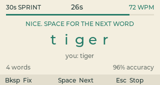

# KEY DASH

**Small keys. Quick fingers.** A pocket typing game for the CardputerZero keyboard.



C++17 / LVGL 9.5. Based on the MIT-licensed CardputerZero Template and the local KEY CRITTER display, keyboard, packaging and screenshot infrastructure. No accounts, network access, root execution, external hardware, or background service.

## Play

- **1**: 30-second sprint.
- **2**: 60-second sprint.
- **3**: untimed practice; finish ten words.
- **Tab**: English / Code vocabulary (64 short words in each).
- **0**: paper / night theme, from the menu or results.
- **4 / hardware Help**: controls, from the menu.
- **Enter**: replay the selected mode.
- **Esc**: return to the menu; from the menu, save and quit.

The clock starts with your first typed character, not on entering the ready screen; empty Space/Enter submissions are ignored. Match the lowercase word, then press **Space or Enter** to confirm it. **Backspace** removes the last typed character. Mistakes stay visible until corrected; wrong words cannot be skipped. All words use plain English letters; uppercase input is accepted case-insensitively. Physical key-repeat is ignored: each character needs a separate press.

The built-in desktop simulator also lets you click the physical keys on the CardputerZero illustration. There is no Japanese IME/romaji-conversion mode in this first version.

## Scoring

- **WPM** = retained correct characters × 12,000 ÷ elapsed milliseconds, capped at 999 for display. A standard word is five characters. Each confirmed word includes its separating space. A correct prefix of the current word counts at timeout.
- Erasing and retyping the same correct letters does **not** inflate WPM.
- **Accuracy** = correct printable-key attempts ÷ all printable-key attempts. Backspace does not count as a new attempt, and correcting a typo does not remove it from the attempt history. Premature/wrong Space/Enter submissions count as errors.
- Timed rounds end at exactly 30 or 60 seconds. Late input cannot extend the round or increase the score. Untimed practice ends after ten correctly confirmed words.
- Personal bests are independent for all three modes and both word packs. A cancelled round creates no record. Practice also records its own best, separately from timed sprints.

## Save data

Best WPM, completed sessions/words, selected mode, word pack and theme are saved locally. Default: `$XDG_CONFIG_HOME/key-dash/state.txt`, or `$HOME/.config/key-dash/state.txt`. Set **KEY_DASH_STATE_DIR** to an absolute directory for isolated testing.

Writes use a temporary file and same-directory rename. Invalid saves are preserved and a visible warning is shown. Saves happen after completed rounds, about once a second after setting changes, and on normal exit / SIGINT / SIGTERM. Power loss or SIGKILL can lose recent unsaved settings. Use one app instance per save directory.

**KEY_DASH_SCREENSHOT_DIR** overrides the normal `~/Pictures/Screenshots` location for **PrintScreen / Fn+J**. Captures are native 320×170 PNGs.

## Build and test on macOS

Requires Apple command-line tools and CMake >= 3.31, Ninja, SDL2, libpng, JPEG, FreeType, fmt and zlib:

```sh
brew install cmake ninja sdl2 libpng jpeg freetype fmt zlib
cmake --preset darwin-arm64
cmake --build --preset darwin-arm64-dbg -j 6
ctest --test-dir build/darwin-arm64 -C Debug --output-on-failure
./build/darwin-arm64/Debug/key-dash
```

Generate a local Apple Silicon preview bundle (bundles local Homebrew dynamic dependencies and ad-hoc signs the `.app`; this is not a notarized macOS distribution):

```sh
python3 scripts/bundle_macos_preview.py
```

A developer-only rendering smoke run takes about 32 seconds. It captures home, help, both themes, vocabulary selection, practice-ready, timed-ready, a typo, active gameplay and the timed result. It runs synthetic inputs only when **KEY_DASH_SMOKE_DIR** is explicitly set. Always use an isolated save directory:

```sh
SDL_VIDEODRIVER=dummy \
KEY_DASH_STATE_DIR="$PWD/temp/smoke-state" \
KEY_DASH_SMOKE_DIR="$PWD/temp/screenshots" \
./build/darwin-arm64/Debug/key-dash
```

The simulator's physical-device illustration comes from the official Template. All screenshots in this repository are simulator captures, not claims of hardware execution.

## CardputerZero build and package

Put an `aarch64-linux-gnu-gcc/g++` toolchain on PATH. The first configure downloads the official BSP and pinned build dependencies:

```sh
cmake --preset cp0-cross
cmake --build --preset cp0-cross-rel -j 6
python3 scripts/package_deb.py
python3 scripts/validate_release.py
```

The Python packager verifies a genuine ELF64 AArch64 executable and produces `dist/key-dash_0.1.0-rev1_arm64.deb`. It works on macOS, whose CPack distribution lacks the DEB generator. The device package contains the binary, APPLaunch entry, icon, documentation and applicable static-dependency licenses; no daemon is installed.

After copying the package to the device:

```sh
sudo apt install ./key-dash_0.1.0-rev1_arm64.deb
```

APPLaunch starts `/usr/bin/key-dash` as the logged-in user. The default display is `/dev/fb0`; the existing platform driver discovers evdev keyboards, with A–Z, digits, Space, Enter, Backspace and Tab mapping. Existing non-root access to the device nodes is required. Do not run as root.

**Physical-device execution is not yet verified.** Cross-compilation and simulator tests do not establish display/input compatibility or performance on a real CardputerZero.

## Store preparation

`app-builder.json` is an unpublished draft. All seven optional permissions are false. The source URL is omitted until a real source repository exists, and the globally unique four-character share code is deliberately blank. `scripts/validate_release.py --require-store` rejects those unfinished fields; the inherited template validator also rejects the missing source URL. No repository URL, share code or hardware demonstration is fabricated.

Before submission, test on the real device and film **APPLaunch → start → typing and typo correction → round result → exit**. Attach that physical-device demo to the Store submission PR. Simulator video is not a substitute. Publishing to GitHub or the Store is a separate action.

## Structure / license

- `src/model/typing_model.*`: words, attempts, accuracy, time limits, WPM and record persistence, without LVGL.
- `src/viewmodel/typing_viewmodel.*`: key actions, round finalization and reactive updates.
- `src/view/screens/typing_screen.*`: native 320×170 home, game, results and help.
- `src/platform/monotonic_clock.h`: shared monotonic clock for keys, rendering and deadlines.
- `tests/typing_model_tests.cpp`, `tests/typing_controller_tests.cpp`: correction history, score invariants, deadline boundaries, persistence and keyboard routing.

MIT. Existing Template notices remain intact. The original keycap monogram is generated by `scripts/generate_icon.py`. Third-party static licenses accompany the Debian package, and macOS dependency licenses are in the preview's Resources directory.
