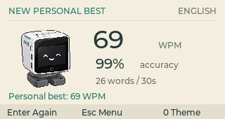
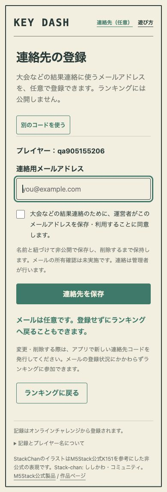

# KEY DASH 0.3.0 検証

- アプリ: 9dbf136、公開サイト/API: 75275f3。GitHub Pagesの公開ジョブ成功。Worker更新成功。
- Mac/ARM64ビルド成功。モデル/controller 2テスト、API/SQLite 13テスト成功。
- ネイティブ→実ローカルD1で登録・30秒プレイ・ミス修正・スコア送信・ランキング・連絡先QR発行と失効を確認。
- 320×170の実描画PNGからQRを独立デコーダーで読取確認。
- Webフォームで明示同意必須、保存・変更・削除、非公開性、削除後スコア保持を確認。テストメールはローカルD1だけで使用・削除済み。
- 公開サイトで任意連絡先の入口と無効コードの拒否を確認。公開側に架空スコアやメールは登録していません。
- 320/390pxとPC画面を確認。ブラウザーconsole警告・エラーなし。
- DebianのARM64 ELF、APPLaunch、実行権限、画像・ライセンス・manifestを検査。Macプレビューの署名検証成功。

## 表示

## 残る実機確認

CardputerZero実機で入力・Wi-Fi・画面上QRの読取確認が必要です。Store共有コードと実機デモ動画は未準備で、Store投稿はしていません。イラストは公式K151を参考にした独自表現であり、公式アプリではありません。
